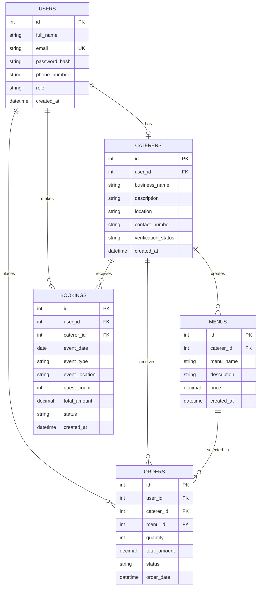

# tpka-sokocater-platform

## Database Schema

SokoCater uses a relational database to manage users, catering businesses, menus, orders, and event bookings.

### Database Tables

The database consists of five main tables:

1. **Users:** Stores registered user information, including customers and caterers.
2. **Caterers:** Stores catering business profiles and details.
3. **Menus:** Stores menus created by catering service providers.
4. **Orders:** Stores customer orders and their associated menu selections.
5. **Bookings:** Stores event catering booking information.

### Entity Relationship Diagram (ERD)

### Database Relationships

| Relationship | Description |
|---|---|
| Users – Caterers | A user can have one caterer profile. |
| Caterers – Menus | A caterer can create multiple menus. |
| Users – Orders | A user can place multiple orders. |
| Caterers – Orders | A caterer can receive multiple orders. |
| Menus – Orders | A menu can be selected in multiple orders. |
| Users – Bookings | A user can make multiple bookings. |
| Caterers – Bookings | A caterer can receive multiple bookings. |

### Database Keys

- **Primary Key (PK):** Uniquely identifies each record in a table.
- **Foreign Key (FK):** Establishes relationships between tables.
- **Unique Key (UK):** Ensures that a value, such as an email address, is not duplicated.

The database schema will be implemented using Flask-SQLAlchemy and a relational database.
